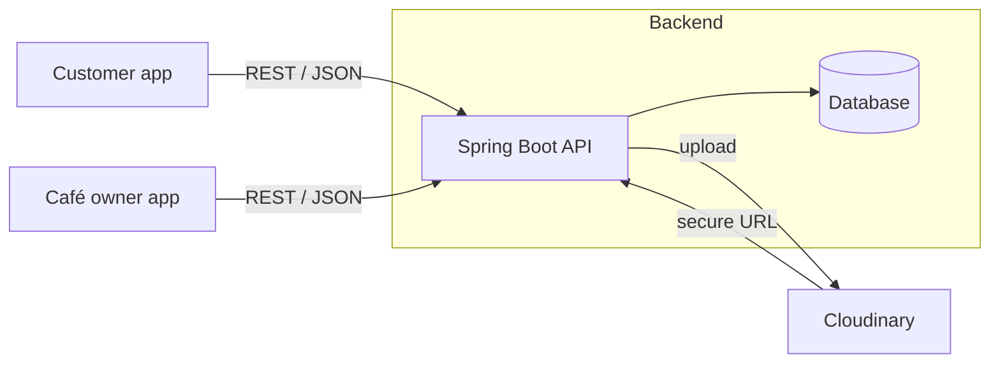

<p align="center">
  
</p>

<h1 align="center">Fanjano</h1>

<p align="center">
  <b>A café ordering platform for Doha, with Moments: film your cup, get featured, earn rewards.</b>
</p>

<p align="center">
  
  
  
  
</p>

---

## About

Fanjano connects coffee lovers with the cafés around them. Customers browse nearby cafés and menus, customise and order a drink, pay securely, and track the order live. After pickup they can film a short **Moment** of their cup. The café that made it sees it, can feature or reply to it, and can reward the customer.

Cafés get their own partner app to run the shift: orders, menu, Moments inbox, stories, promotions and insights.

This repository contains the **Spring Boot REST API**, the **client app**, and the complete **UI/UX design system** (81 screens).

## Features

**Customer**
- Discover cafés, food trucks and bakeries near you, with search, filters and a map view
- Menu browsing with item customisation (size, sugar, ice, add-ons, notes)
- Cart, promo codes, and checkout for Pickup, Delivery or Dine-in
- Live order tracking and ready-for-pickup code
- Ratings and reviews, favourites, saved addresses and payment methods
- Rewards: Beans balance, membership tiers and a stamp card

**Moments**
- Film a photo or short video of your order and send it to the café
- Privacy first: only the café sees it unless you allow featuring or community sharing
- Cafés reply, feature the Moment and attach a reward (voucher, Beans or discount)

**Café owner**
- Dashboard with orders, revenue and prep-time stats
- Order queue with a step-by-step status flow
- Menu management with photo upload
- Moments inbox, stories with analytics, reviews and complaints
- Promotions, store settings (hours, delivery radius, staff accounts)

## Screenshots

<p align="center"></p>
<p align="center"></p>
<p align="center"></p>

## Tech stack

| Layer | Technology |
|-------|------------|
| Backend | Java, Spring Boot, REST API |
| Database | `<MySQL / PostgreSQL>` with Spring Data JPA |
| Media | Cloudinary (image upload, returns a hosted URL) |
| Client | `<your frontend stack>` |
| Design | Figma-ready SVG library, design tokens, Quicksand + Plus Jakarta Sans |

## Architecture



**Image flow:** the client sends an image to the API, the API uploads it to Cloudinary, and only the returned secure URL is stored in the database and served to clients.

## Getting started

### Prerequisites
- JDK `<17+>`
- `<Maven / Gradle>`
- A `<MySQL / PostgreSQL>` database
- A free [Cloudinary](https://cloudinary.com) account

### Run the API

```bash
git clone https://github.com/Melikash98/Fanjano-App.git
cd Fanjano-App

# configure environment (never commit real values)
cp .env.example .env

./mvnw spring-boot:run
```

### Configuration

| Variable | Description |
|----------|-------------|
| `DB_URL` | JDBC URL of your database |
| `DB_USERNAME` / `DB_PASSWORD` | Database credentials |
| `CLOUDINARY_CLOUD_NAME` | Cloudinary cloud name |
| `CLOUDINARY_API_KEY` / `CLOUDINARY_API_SECRET` | Cloudinary credentials |

> Variable names should match your `application.yml`. Secrets stay in environment variables and are never committed.

### API documentation

Once the API is running, interactive docs are available at `http://localhost:8080/swagger-ui.html` *(if Swagger/OpenAPI is enabled)*.

## Design system

The full design is included in [`/design`](design/): 81 screens, 8 boards, and design tokens ready to import into Figma.

| Token | Value |
|-------|-------|
| Primary (caramel) | `#D08A3E` → `#B8702A` |
| Espresso | `#3B1F14` |
| Cream (background) | `#F8F2E8` |
| Display font | Quicksand |
| UI font | Plus Jakarta Sans |
| Frame | 393 × 852, 8-pt spacing grid |

<p align="center"></p>

## Roadmap

- [ ] Dark theme screens (tokens are ready)
- [ ] Arabic language and RTL layout
- [ ] Accessibility pass: WCAG AA contrast for primary buttons and secondary text
- [ ] Automated tests and CI pipeline
- [ ] Docker Compose for one-command setup

## Contributing

Contributions are welcome. Please read [CONTRIBUTING.md](CONTRIBUTING.md) and the [Code of Conduct](CODE_OF_CONDUCT.md) first. To report a vulnerability, see [SECURITY.md](SECURITY.md). Accessibility guidelines are in [ACCESSIBILITY.md](ACCESSIBILITY.md).

## License

Released under the [MIT License](LICENSE).

## Author

**Melikash98** · [Portfolio case study](https://mshooryabi.com/html/projects.html?id=project-fanjano-app)
